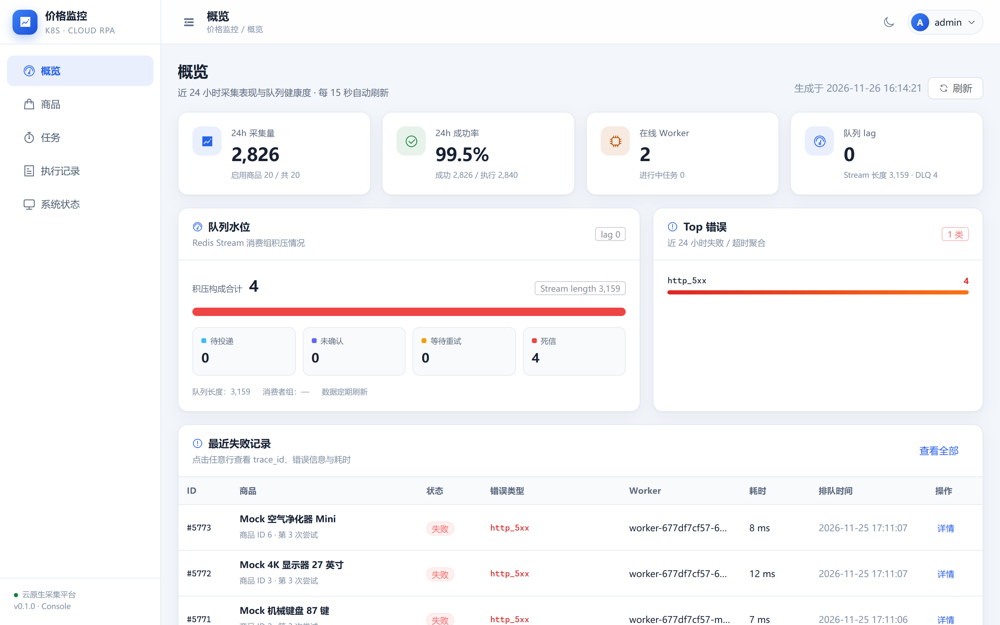
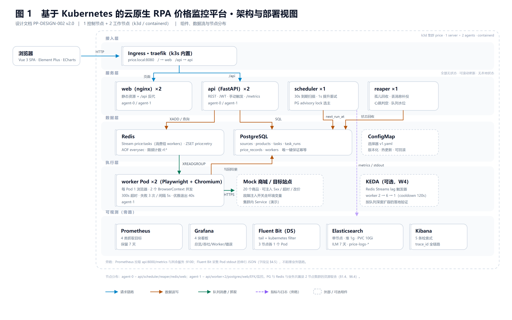
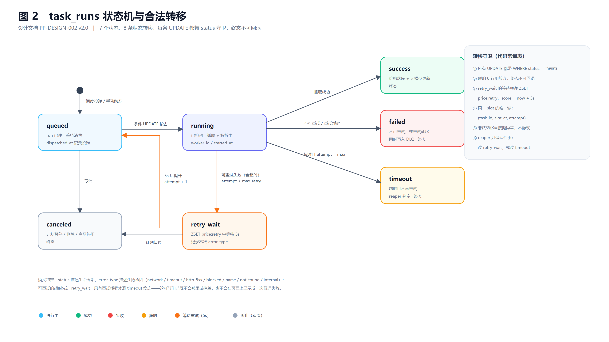
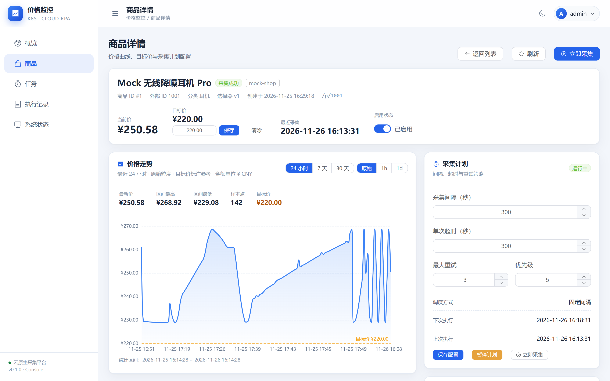
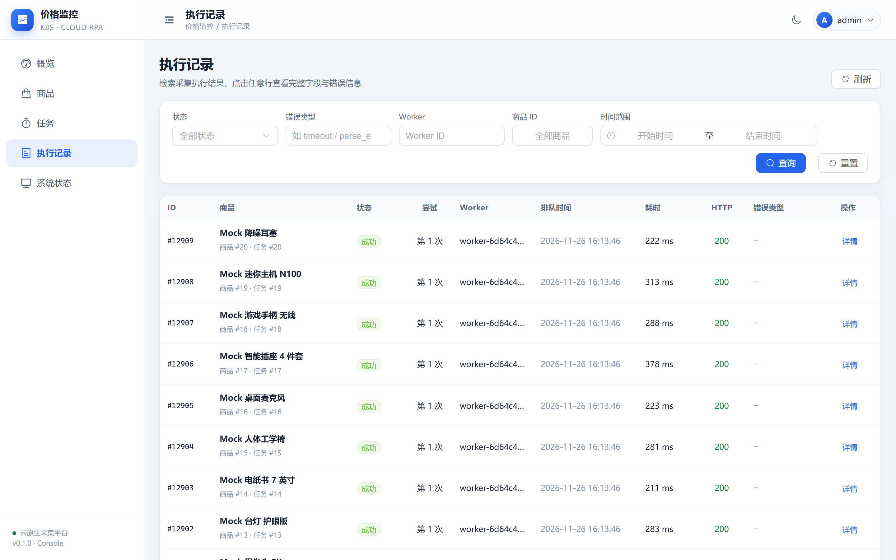
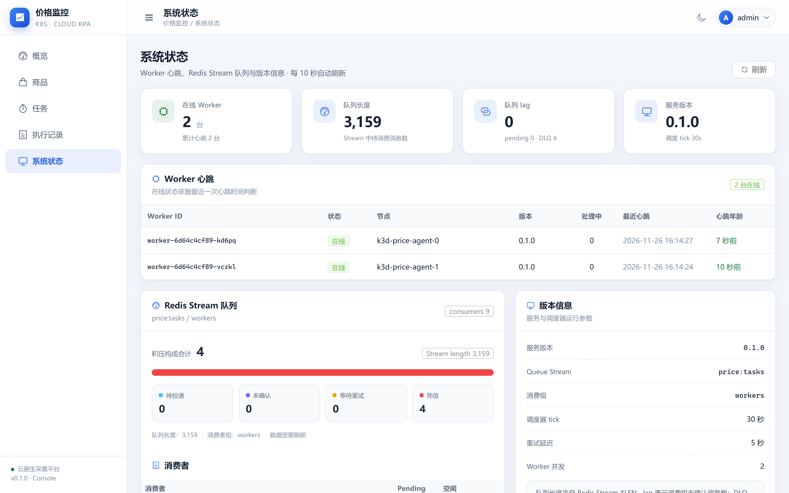

<div align="center">

# Price Platform

**云原生 RPA 价格监控平台 · 调度与执行彻底解耦**

PostgreSQL 行锁做调度，Redis Stream 做队列，Playwright 驱动真实浏览器采集，
KEDA 按队列深度弹性伸缩，Prometheus + Grafana + EFK 提供全链路可观测性。




</div>

---

## 这个项目解决什么问题

电商价格监控听起来是"写个爬虫定时抓一下"，真正难的是**跑得住**：

- 目标站不稳定：5xx、超时、验证码、页面改版，一次失败不能变成永久丢数据；
- Worker 会挂：Pod 被驱逐、浏览器 OOM，任务卡在 `running` 没人收尸；
- 同一时间槽被重复投递：价格表出现重复点，曲线变成锯齿；
- 流量突增：整点对齐 + 重试叠加，队列瞬间堆积。

所以这里没有用 `while True: sleep(1800); crawl()`，而是把**调度、队列、执行、回收**拆成四个组件，
用"至少一次投递 + 三层幂等"把语义收敛成"有效一次"，再用指标和日志回答"这个任务现在在哪、为什么失败"。

## ✨ 核心特性

| | 能力 | 实现 |
|---|---|---|
| 🕒 | **30 秒级精确调度** | `FOR UPDATE SKIP LOCKED` 批量锁行、时间槽推进不补跑、advisory lock 保证单调度者 |
| 📮 | **至少一次 + 有效一次** | Redis Stream 消费组（ACK / PEL / `XAUTOCLAIM`）+ 两层唯一键 + 条件 UPDATE 抢占 |
| 🔁 | **失败可控** | 错误分类（network / timeout / 5xx / blocked / parse / not_found）、5 秒延时重试（ZSET，不占 Worker 槽位）、3 次后进 DLQ |
| 🧹 | **自愈** | reaper 回收孤儿任务（超时 / 心跳丢失）、补投未投递消息、修复僵尸重试 |
| 🌐 | **真实浏览器采集** | Playwright + 任务级 BrowserContext 隔离；也支持 HTTP 适配器（服务端渲染站点更快） |
| 🧩 | **选择器版本化** | ConfigMap 挂载 YAML，按商品选择版本，热更新、秒级回滚 |
| 📈 | **可观测** | 20+ Prometheus 指标、Grafana 总览看板、Fluent Bit → ES → Kibana 全链路日志、Alertmanager webhook 落库 |
| ⚡ | **弹性** | KEDA 按 Stream lag 扩缩（秒级指标、冷却 120s） |
| ☸️ | **云原生部署** | k3d 1 控制面 + 2 工作节点、containerd、探针、PDB、NetworkPolicy、资源配额 |

## 🏗 架构



**三条主链路**

1. **调度**：scheduler 每 30s 扫描到期计划 → 锁行推进 `next_run_at` → 写 `task_runs(queued)` → 提交后再 `XADD`（先写库后投递，投递失败由 reaper 按 `dispatched_at IS NULL` 精确补发）。
2. **执行**：Worker `XREADGROUP` 取任务 → 条件 UPDATE 抢占（`WHERE status='queued'`）→ Playwright 抓取 → 单事务写价格 + 更新读模型 + 标记成功。
3. **失败**：可重试错误写 `retry_wait` 并 `ZADD price:retry`，1s 循环提升为下一次 attempt；重试耗尽进 DLQ；超时/失联由 reaper 兜底。



> 状态与原因分开：`status` 描述生命周期（queued / running / retry_wait / success / failed / timeout / canceled），
> `error_type` 描述失败原因。因此"超时但还会重试"是 `retry_wait + timeout`，"超时且重试耗尽"才是终态 `timeout`。

## 🧱 技术栈

| 层 | 选型 | 为什么 |
|---|---|---|
| 调度 | PostgreSQL + asyncpg | 任务定义就在库里，重启不丢；行锁让分片成为可能 |
| 队列 | Redis Stream 消费组 | 有 ACK / PEL / lag，比 List 可靠，比 Kafka 轻 |
| 执行 | Playwright（Chromium） | 目标是 JS 渲染页；context 隔离 + 自动等待 |
| 存储 | PostgreSQL 16 | 唯一键是幂等的最后一道闸 |
| 接口 | FastAPI + SQLAlchemy 2.0 | 28 个 REST 端点，JWT，OpenAPI 自带文档 |
| 前端 | Vue 3 + TS + Element Plus + ECharts | 7 个页面，价格曲线支持 24h/7d/30d × raw/1h/1d |
| 可观测 | Prometheus / Grafana / EFK / Alertmanager | 指标、看板、日志检索、告警闭环 |
| 弹性 | KEDA | 原生 Redis Streams lag 触发器 |
| 部署 | k3d + containerd | 一条命令起 1+2 集群，贴近真实节点拓扑 |

## 🚀 快速开始

### 本地跑（单机，5 分钟）

```bash
# 依赖：Docker Desktop、Python 3.10+、Node 20+
python -m venv .venv && .venv/Scripts/pip install -e ".[dev,worker]"
cp .env.example .env

docker compose -f deploy/compose/docker-compose.dev.yml up -d postgres redis
python -m alembic upgrade head
python scripts/seed.py --interval 1800        # 20 个商品 + 采集计划
python scripts/dev.py up                      # mock-shop / api / scheduler / reaper / worker
```

打开 <http://127.0.0.1:8000/docs> 看 API，账号 `admin / admin123`。

### Kubernetes（k3d 1 server + 2 agents）

```bash
k3d cluster create price --servers 1 --agents 2 --api-port 6550 \
  -p "8080:80@loadbalancer" -p "8443:443@loadbalancer" \
  --volume "$PWD/deploy/k3d/registries.yaml:/etc/rancher/k3s/registries.yaml" --wait

docker build -f docker/Dockerfile --target api    -t price/api:v1 .
docker build -f docker/Dockerfile --target worker -t price/worker:v1 .
docker build -t price/web:v1 frontend
docker build -t price/mock-shop:v1 -f mock-shop/Dockerfile .
k3d image import -c price price/api:v1 price/worker:v1 price/web:v1 price/mock-shop:v1

kubectl apply -k deploy/base
kubectl apply -k deploy/observability
```

浏览器打开 <http://127.0.0.1:8080>。`k3d` 用 `winget install k3d` 安装即可。完整步骤（镜像加速、containerd mirror、PV 取舍）见 [docs/DEPLOY.md](docs/DEPLOY.md)。

## 📊 可观测性

| 概览 | 商品详情 |
|---|---|
|  |  |
| **执行记录** | **系统状态** |
|  |  |

- **Grafana**：采集成功率、任务吞吐、P95 耗时、队列水位、错误分布、重复消费率；
- **Kibana**：`price-logs-*` 索引，按 `trace_id` 串联 API → 调度 → Worker 全链路；
- **Alertmanager**：5 条规则（成功率、队列积压、Worker 掉线、DLQ 增长、调度延迟），webhook 写入 `alerts` 表。

## 🧪 测试

```bash
pytest tests/unit -q            # 36 个单元用例（时间槽、错误分类、消息契约、解析器）
pytest -m integration -q        # 4 个集成用例（真实 PG + Redis）
ruff check src tests
```

压测与故障注入记录见 [docs/perf/loadtest.md](docs/perf/loadtest.md)：
300 任务全部成功、70% 5xx 注入下重试与 DLQ 正常工作、伪造孤儿任务 22s 内被回收、KEDA 1 → 5 → 1 扩缩。

## 📁 目录结构

```
price-platform/
├── src/price_platform/
│   ├── common/          # 配置、DB、Stream、日志、指标、错误分类
│   ├── scheduler/       # 30s 到期扫描 + 1s 重试提升
│   ├── worker/          # 消费组、Playwright、适配器、限频
│   ├── reaper/          # 孤儿回收、补投、队列指标
│   └── api/             # FastAPI 路由与 schema
├── frontend/            # Vue 3 + Element Plus + ECharts
├── mock-shop/           # 可注入故障的演示商城
├── deploy/              # k8s manifests / observability / keda / compose
├── alembic/             # 数据库迁移
├── scripts/             # seed / demo 数据集 / 压测 / 截图 / 本地栈
└── tests/               # unit + integration
```

## 📚 文档

- CI 工作流示例：[docs/ci.yml](docs/ci.yml)（需 `workflow` 权限的 token 才能推送到 `.github/workflows/`）
- [部署手册](docs/DEPLOY.md) · [演示脚本](docs/demo.md) · [实施记录](docs/STATUS.md) · [压测与故障注入](docs/perf/loadtest.md)

## 🗺 Roadmap

- [ ] 调度分片（按 `task_id % N` 起多个 scheduler）
- [ ] 价格表月度分区 / TimescaleDB 连续聚合
- [ ] 告警页面（当前告警通过 API + Grafana 展示）
- [ ] 真实站点适配器（默认关闭，遵守 robots 与访问频率）

## ⚠️ 合规说明

仓库自带的 `mock-shop` 是演示目标站，完全可控；真实站点适配器默认关闭。
爬取请遵守目标站 `robots.txt` 与服务条款，控制频率，不采集个人信息。

## 📄 License

[MIT](LICENSE)


